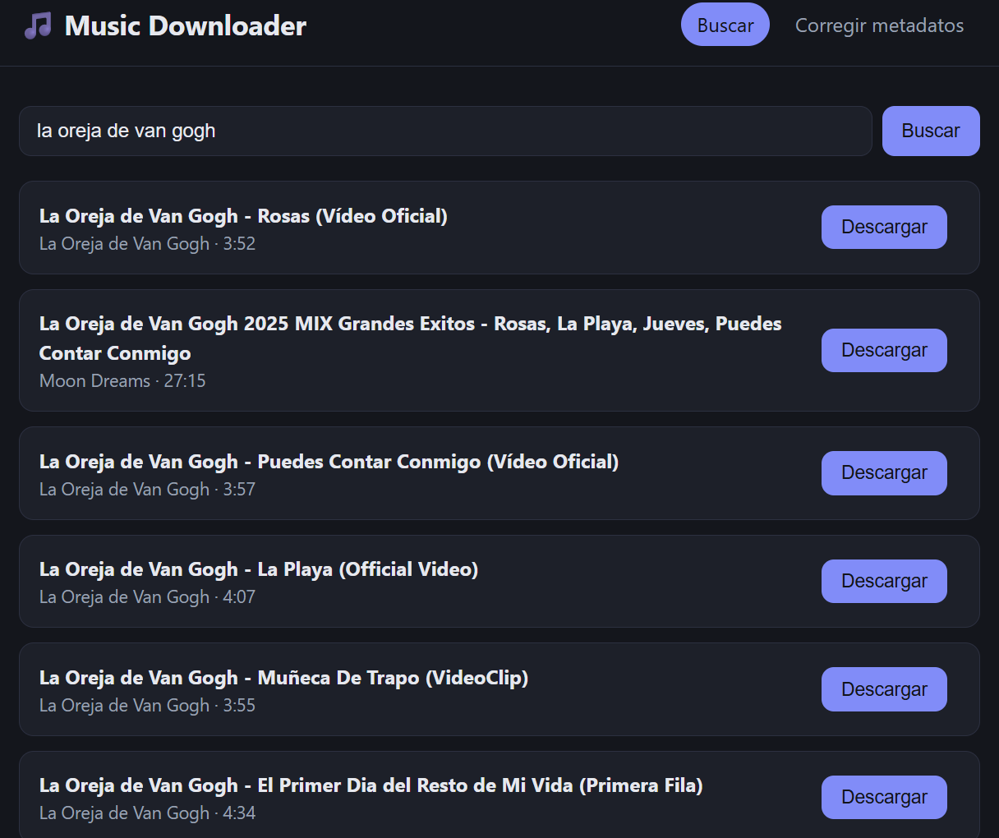

# 🎵 Music Downloader

Descargador de música personal basado en [yt-dlp](https://github.com/yt-dlp/yt-dlp),
con una interfaz de consola y una interfaz web local hecha con Django.



## Funciones

- Búsqueda en YouTube con duración y marca de «ya descargada».
- Descargas en cola con barra de progreso (interfaz web).
- Audio en su formato original, sin recodificar (normalmente Opus).
- Carátula recortada a cuadrado e incrustada en el archivo.
- Historial para no repetir descargas y lista de URLs fallidas para reintentar.
- Corrección de metadatos: artista(s) y título a partir del nombre del archivo,
  limpiando sufijos como «(Official Video)» y reconociendo varios artistas
  (`ft`, `feat`, `x`, coma).
- Interfaz de consola con menú: URL individual, lote desde `links.txt`,
  reintento de fallidas, búsqueda y corrección de metadatos.

## Requisitos

- Python 3.x (desarrollado con 3.14)
- [ffmpeg](https://ffmpeg.org/) y [Node.js](https://nodejs.org/) instalados y en el PATH

## Instalación (Windows, PowerShell)

```powershell
git clone https://github.com/IvanS2504/music_downloader.git
cd music_downloader
python -m venv .venv
.venv\Scripts\activate
pip install -r requirements.txt
```

## Uso

**Interfaz web** (abre http://127.0.0.1:8000):

```powershell
python manage.py migrate     # solo la primera vez
python manage.py runserver
```

**Interfaz de consola:**

```powershell
python main.py
```

También puedes usar los accesos `iniciar_web.bat`, `iniciar_consola.bat` y
`actualizar.bat` (actualiza yt-dlp; ejecútalo cuando las descargas empiecen a fallar).

Las canciones se guardan en la carpeta `downloads/`.

## Pruebas

```powershell
pip install -r requirements-dev.txt
python -m pytest
```

## Estructura

| Archivo | Para qué sirve |
|---|---|
| `main.py` | Menú de consola |
| `descargas.py` | Opciones de yt-dlp, descarga y búsqueda |
| `historial.py` | Historial de descargas y URLs fallidas |
| `metadatos.py` | Limpieza de nombres y etiquetas |
| `trabajos.py` | Cola de descargas en segundo plano |
| `config.py` | Rutas del proyecto |
| `sitio/`, `buscador/` | Proyecto y app de Django (interfaz web) |
| `tests/` | Pruebas con pytest |

## Notas

- La interfaz web está pensada para usarse **solo en tu propia computadora**
  (`127.0.0.1`). No la expongas a internet.
- Tu historial, tus enlaces y tus descargas no se suben al repositorio
  (están en `.gitignore`).

## Aviso

Proyecto para uso personal y de aprendizaje. Cada persona es responsable de
respetar los términos de servicio de YouTube y las leyes de derechos de autor
de su país.

## Pendiente

- Metadatos con MusicBrainz (álbum, año, nombres oficiales).
- Vista de biblioteca y edición de metadatos desde la web.